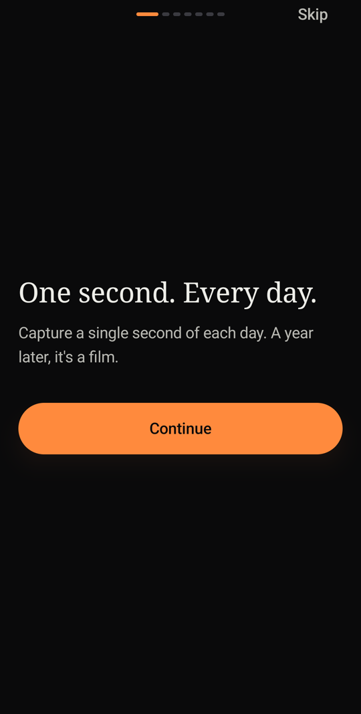
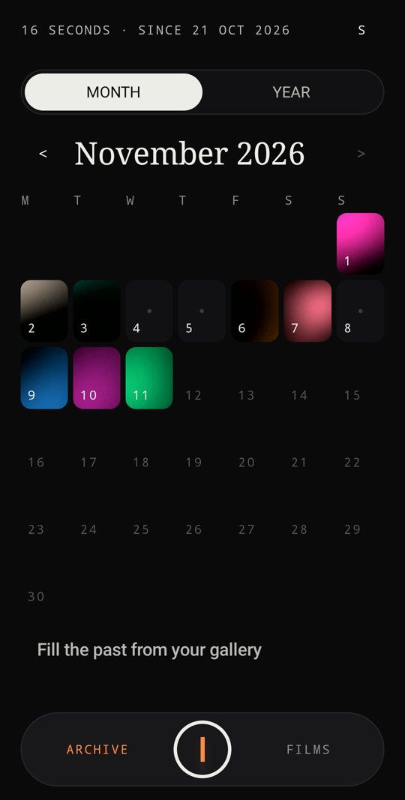
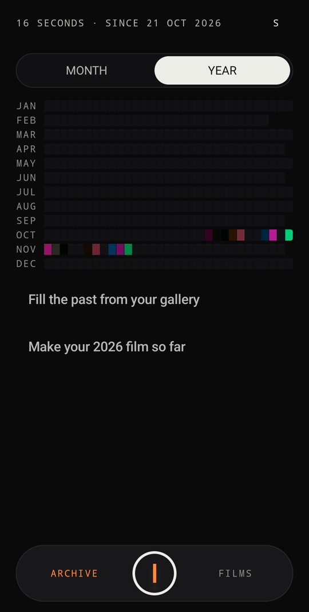
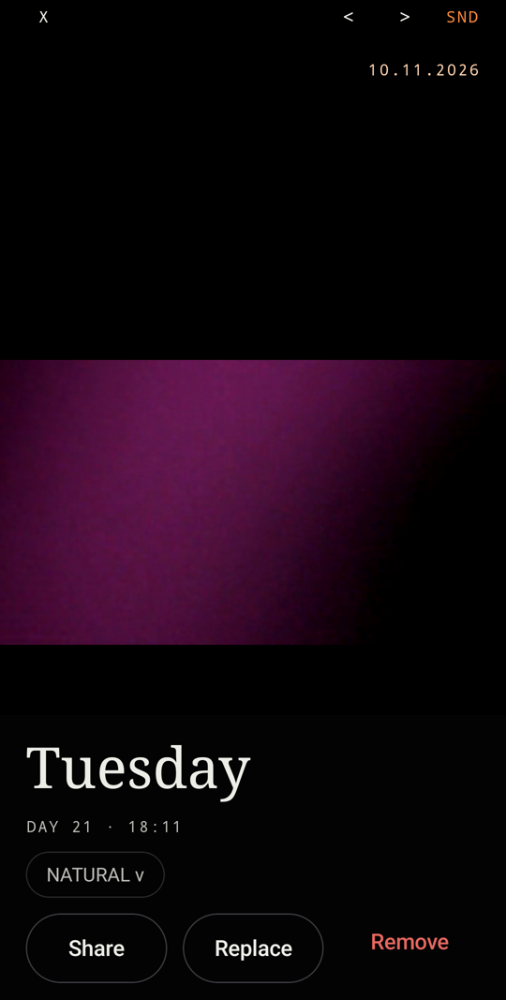
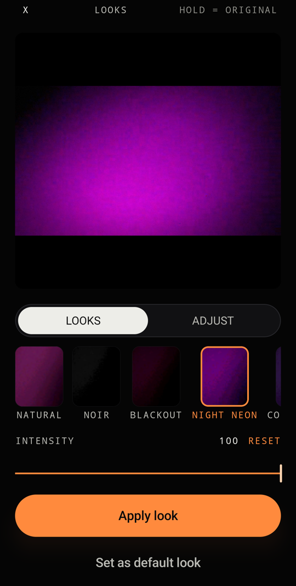
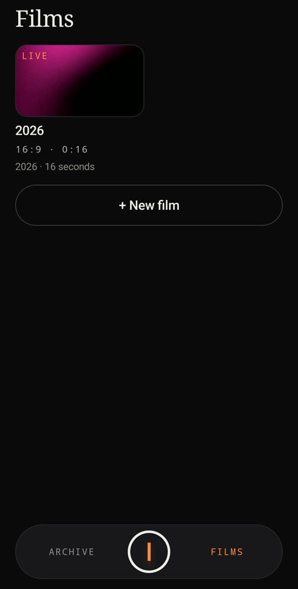
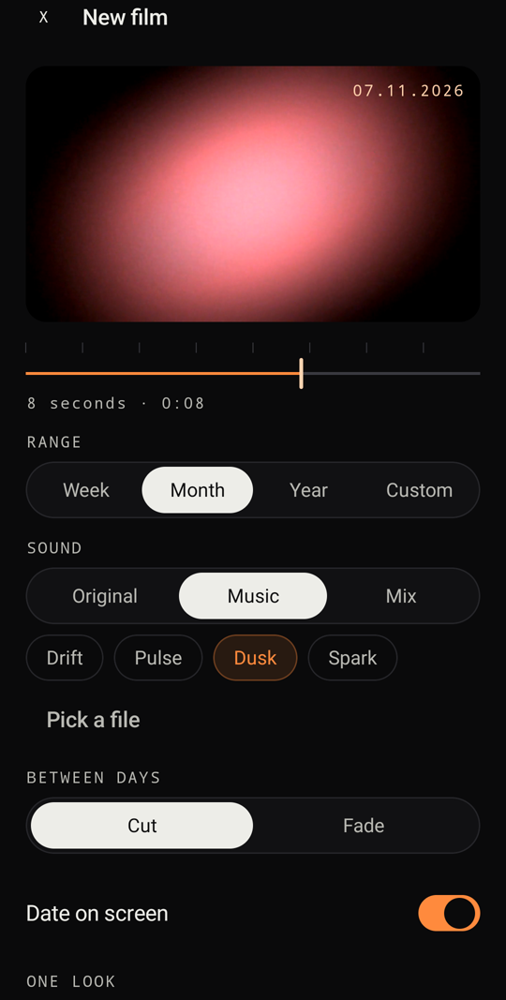
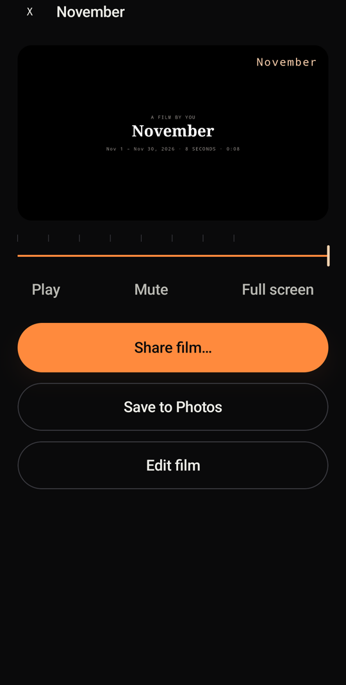
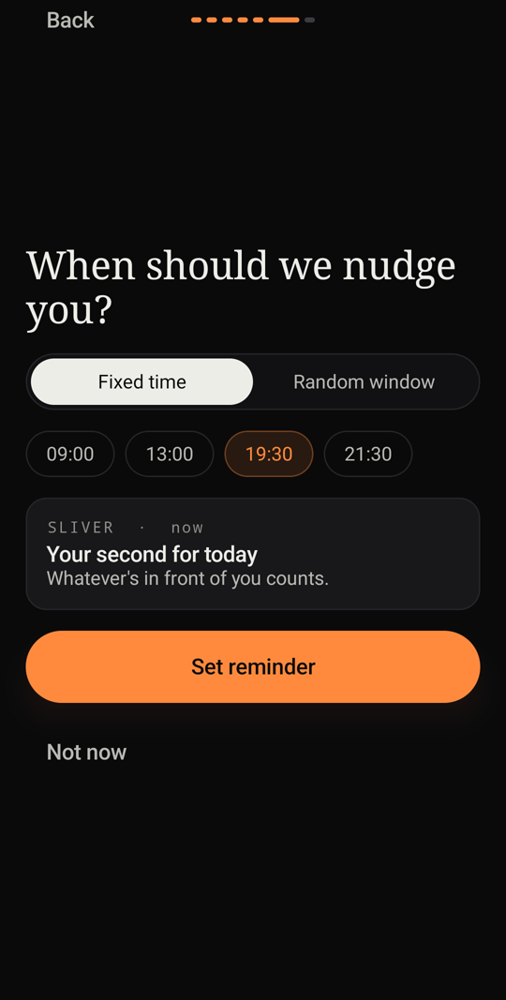
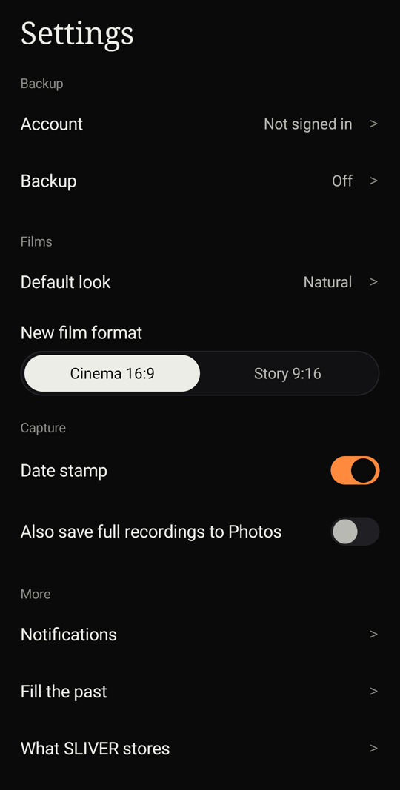

<div align="center">

# SLIVER

### One second. Every day.

A private, cinematic video diary. Capture a single second of each day, watch your year add up, and turn it into a film.


</div>

---

<!-- SCREENSHOTS:START -->
<div align="center">

<table>
<tr>
<td align="center"><br><sub>One second. Every day.</sub></td>
<td align="center"><br><sub>Your month of seconds</sub></td>
<td align="center"><br><sub>The whole year at a glance</sub></td>
<td align="center"><br><sub>Every day, full screen</sub></td>
<td align="center"><br><sub>Looks, with live preview</sub></td>
</tr>
<tr>
<td align="center"><br><sub>Films library</sub></td>
<td align="center"><br><sub>Film builder</sub></td>
<td align="center"><br><sub>Premiere and share</sub></td>
<td align="center"><br><sub>Gentle daily reminder</sub></td>
<td align="center"><br><sub>Settings</sub></td>
</tr>
</table>

<sub>Screens captured from the debug build on a real Android phone, with generated demo clips.</sub>

</div>
<!-- SCREENSHOTS:END -->

## What it is

SLIVER keeps **one 1.000-second clip per day**. Record it, pick it from your gallery, or turn a photo into a second. Your days fill a calendar of seconds, and the calendar becomes films: a week, a month, a year, any range you choose.

It is not a social network. There is no feed, no followers and no streak to lose.

## Features

| | |
|---|---|
| **Capture in seconds** | The app opens straight to the camera. Tap to record, or hold to record while held. |
| **Auto-pick the best second** | SLIVER finds the strongest second of any clip. You keep the final say with a fixed 1 s window you drag across the filmstrip, with haptic ticks and a lock-in pulse. |
| **Three ways to add a day** | Record in the app, import a gallery video, or import a photo that becomes a second with a slow zoom. |
| **Looks** | Natural, Noir, Blackout, Night Neon, Cold Steel, Ember, VHS 94, Hard Light and Ghost, with per-look intensity. Adjust sharpness, contrast, grain, vignette, fade and saturation. Hold to compare. |
| **Archive** | A month grid and a year view of your seconds. Memory cards bring back "one month ago" and "one year ago". |
| **Fill the past** | An opt-in tool that finds empty days and fills them from your gallery by taken date, with one-tap undo. |
| **Films** | Build a film from a week, month, year or custom range. Cinema 16:9 or Story 9:16, original sound or music, cut or fade, optional date stamp and one look for the whole film. |
| **Premiere** | The finished film opens with a title card, then plays, saves to Photos or shares. |
| **Year in Seconds** | Your whole year in one film. |
| **Reminders and widgets** | Fixed-time or random-window reminders, a home-screen widget and a Quick Settings tile. |
| **Your Drive, your data** | Optional backup and restore to *your own* Google Drive. Nothing else is uploaded. |

## Principles

- **Private by default.** Works fully offline. Network is used only for your own Google Drive backup.
- **No guilt.** No streaks, no nagging copy, no mood tags, no day notes.
- **No ads, no paywall, no analytics, no tracking.**
- **Your originals are safe.** Gallery files are read-only. Looks and date stamps are never burned into saved days, only into exports.
- **Dark, cinematic, one accent.** Near-black surfaces with a single ember (`#FF8A3D`) accent.

## Tech

- **Kotlin Multiplatform** with **Compose Multiplatform**. Android is the only target fully built and tested; iOS builds and launches in the simulator with media features still placeholders.
- Shared in `commonMain`: UI, navigation, domain logic (auto-pick scoring, film plans, reminder rules, backup state machine), Room KMP, DataStore, Ktor, Koin, Coil 3.
- Android in `androidMain`: CameraX, Media3 (Transformer, effects), WorkManager, Glance widgets, Credential Manager.
- Min SDK 29.

```
composeApp/src/
  commonMain/kotlin/app/sliver/   core · domain · data · platform · feature
  androidMain/                    platform implementations
  iosMain/                        stubs
  commonTest/                     unit tests
```

## Build and run

```bash
./gradlew :composeApp:assembleDebug      # build
./gradlew :composeApp:testDebugUnitTest  # unit tests
./gradlew :composeApp:installDebug       # install on a connected device
```

Optional setup is listed in [`HANDOFF.md`](HANDOFF.md) once generated: royalty-free music tracks and a Google Cloud OAuth client for Drive backup. Without them the app uses silent placeholders and a fake backup.

## Documentation

[Spec](docs/SPEC.md) · [Design](docs/DESIGN.md) · [Data](docs/DATA.md) · [Architecture](docs/ARCHITECTURE.md) · [Tasks](tasks/INDEX.md)

## Status

v0.1: all 37 planned tasks are built; **151 unit tests pass** and the debug build installs and runs on a real Android phone (camera, trim, archive, looks, film builder, render, settings).

Known gaps: fonts are system placeholders until the OFL fonts are added; the four music tracks are generated stand-ins; Google sign-in and Drive backup run against fakes until an OAuth client is configured; the live camera preview does not apply looks yet. Details in [`HANDOFF.md`](HANDOFF.md).

Built task by task from [`tasks/`](tasks/INDEX.md) by an automated agent workflow.
