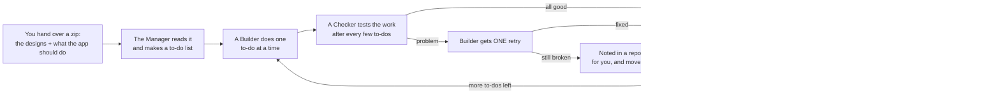

# How the app gets built, in plain words

**Nobody ever stops to ask you.** If something is missing (a password, a key),
the Manager uses a stand-in, writes down what you need to add later, and keeps going.

**If the AI runs out of allowance**, it waits for it to refill and picks up where it stopped.
